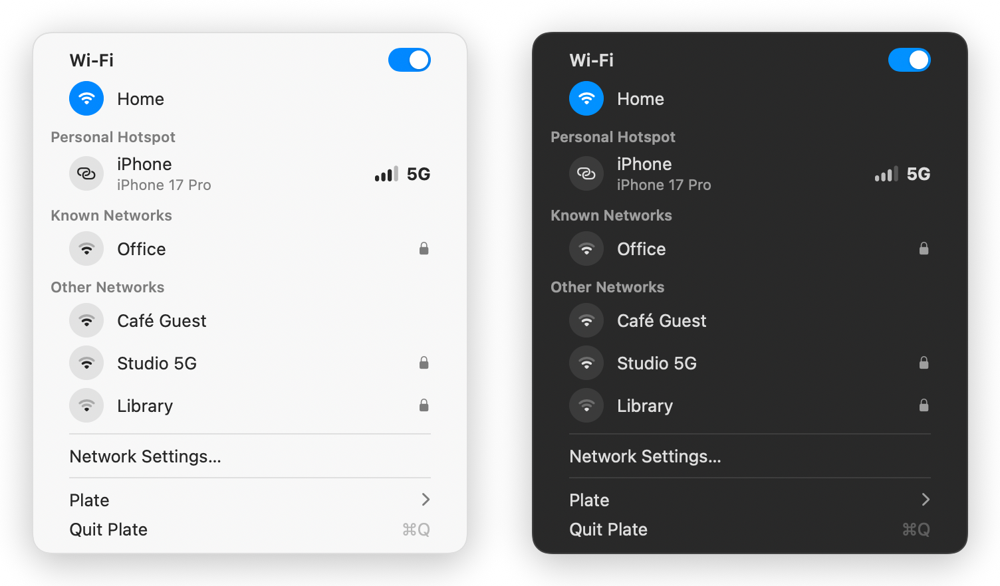
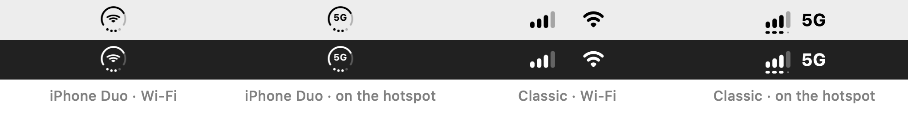

<p align="center">
  
</p>

<h1 align="center">Plate</h1>

<p align="center">
  A macOS menu bar app that replaces the system Wi-Fi menu: it shows Wi-Fi, Ethernet and your iPhone's Instant Hotspot (signal, cellular network type like 5G/LTE, and battery), lists nearby networks and joins them.
</p>

<p align="center">
  
</p>

## In the menu bar

<p align="center">
  
</p>

The item shows the Mac's connection and, when your iPhone is nearby, its cellular signal, in one of two styles picked under *Plate › Menu Bar Style*:

- **iPhone Duo** (default), after the iPhone Duo's circular status icon: the Mac's connection in the center (Wi-Fi with its signal, Ethernet, or the network type like 5G/LTE while on the iPhone's hotspot), the iPhone's signal in the 4 dots, and its battery in the open ring.
- **Classic**: the iPhone's signal bars beside the Wi-Fi or Ethernet icon, spaced like separate menu bar items. On the hotspot, the bars with the network type next to them, and the battery as marks under the bars.

<p align="center">
  
</p>

When no iPhone is found, both styles show short faint bars (or faint dots), like an iPhone with no service. While the Mac is on the hotspot, a wave sweeps across them, like the iPhone's "searching for network" animation: in Classic each bar grows to its height in the staircase and shrinks back. The animation runs on Core Animation, so it costs no CPU.

## Features

- **Network menu** in the style of the system Wi-Fi menu: a Wi-Fi switch, the current network, *Personal Hotspot* (your iPhone, with its signal and network type the way its status bar shows them; click to turn its hotspot on and join it), *Known Networks*, *Other Networks* (the rest under *More Networks*), and *Ethernet* with the interface and IP address when wired.
- **Join networks** with a click; a password prompt appears for new secured ones. Known networks use the password macOS already has.
- Network names need **Location** access (macOS treats them as location data); the app asks on first launch.
- **Signal bars** (0–4) and **network type** of the iPhone, updated as the iPhone advertises changes.
- **iPhone battery** (optional, off by default): the ring in the iPhone Duo style, or a row of 4 marks under the bars in the Classic style (a full quarter is a segment as wide as its bar, an empty one a small faint dot). Works in both automatic and manual modes. No percentage: the iPhone only advertises its battery in quarters (0, 25, 50, 75, 100).
- **Automatic mode** (default): signal bars always; the network label (5G/LTE) only shows while the Mac is using the iPhone's hotspot.
- **Manual mode**: pick what shows on the hotspot under *Plate* (signal bars, network type).
- The iPhone's marketing model name (`iPhone18,1` → *iPhone 17 Pro*). The *Plate* submenu also has **Refresh** (⌘R), and **Quit Plate** (⌘Q) sits at the bottom.
- **Open at Login** (on by default, toggle in the menu) via `SMAppService`.
- No Dock icon (`LSUIElement`).
- Localized in English and Brazilian Portuguese (String Catalog).

## Requirements

- macOS 27 or later.
- An iPhone with Personal Hotspot, signed in to the same iCloud account, with Bluetooth and Wi-Fi on on the Mac.

## How it works

| Data | Source |
|---|---|
| Network type, signal bars, battery, name and model identifier | `SFRemoteHotspotSession` (Sharing.framework, **private API**), the same source as the macOS Wi-Fi menu |
| Marketing name and model icon | `UTType` with the `com.apple.device-model-code` tag class (UTIs from macOS CoreTypes) |
| Wi-Fi state, nearby networks, joining | CoreWLAN (`CWWiFiClient`, `scanForNetworks`, `associate`) |
| Ethernet and the interface in use | `NWPathMonitor` + `getifaddrs` |
| Turning the iPhone's hotspot on | `SFRemoteHotspotSession enableHotspotForDevice:` (private), which returns the hotspot's network and password |
| Whether the Mac is on the hotspot | `NWPathMonitor.isExpensive` (Network, public API, no Location permission needed) |
| Menu bar item | `NSStatusItem` with the `cellularbars` SF Symbol at 15pt, aligned with the system icons |

`networkType` values sent by the iPhone:

| Value | Network |
|---|---|
| 0 | — |
| 1 | 1x |
| 2 | GPRS |
| 3 | EDGE |
| 4 | 3G |
| 5 | H |
| 6 | 4G |
| 7 | LTE |
| 8 | 5G |

### Limitations

- **Private API**: it can't ship on the Mac App Store and may break with macOS updates.
- **5G SA vs. NSA**: the iPhone only advertises "5G" without telling SA from NSA, so "5G+" can't be shown.
- Updates depend on the iPhone's BLE advertisement; the app restarts the search every 30 seconds to force fresh data.

## Project layout

```
Plate/
├── PlateApp.swift            # App + AppDelegate (no windows)
├── StatusItemController.swift  # NSStatusItem, menu and display options
├── NetworkMonitor.swift        # Wi-Fi (CoreWLAN), Ethernet, Location, scanning and joining
├── NetworkMenuViews.swift      # Custom menu rows (SwiftUI): Wi-Fi switch, network rows, cellular status
├── HotspotDevice+Model.swift   # Marketing name, icon, and the iPhone Duo / Classic glyphs
├── LaunchAtLogin.swift         # Open at Login (SMAppService)
├── SearchAnimationView.swift   # "Searching for network" animation (Core Animation)
├── HotspotMonitor.swift        # SFRemoteHotspotSession + NWPathMonitor
├── Localizable.xcstrings       # String Catalog (en, pt-BR)
└── Plate Icon.icon             # App icon (Icon Composer: Duo circle, with a Dark Background group)
docs/                           # README images and the script that renders them
```

## Building

Open `Plate.xcodeproj` in Xcode and run the **Plate** scheme, or:

```bash
xcodebuild -project Plate.xcodeproj -scheme Plate -configuration Release build
```
